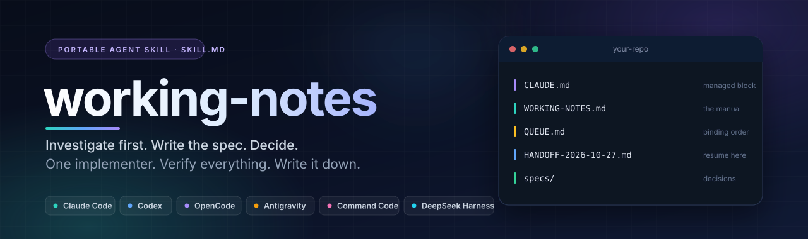
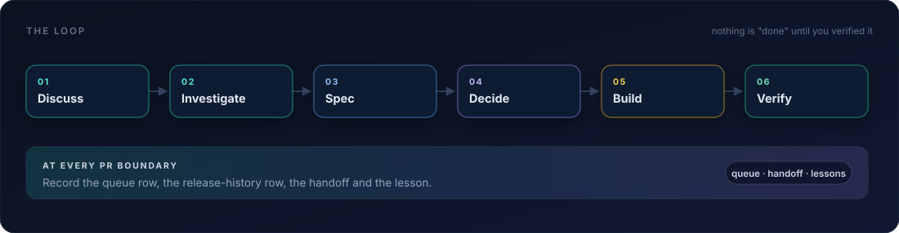

<div align="center">



<h1>working-notes</h1>

<p><strong>The operating manual your AI coding agent was missing.</strong></p>

<p>A portable <strong>Agent Skill</strong> (<code>SKILL.md</code>) that turns any repository into an orchestrated project:<br>
investigate before building, write a spec, record the decision, run <em>one</em> implementer,<br>
verify every claim yourself, and keep a queue, handoff and lesson log that survive the session.</p>

<p>Runs in <strong>Claude Code</strong>, <strong>Codex</strong>, <strong>Cursor</strong>, <strong>GitHub Copilot</strong>, <strong>Gemini CLI</strong>, <strong>OpenCode</strong>,
<strong>Antigravity</strong>, <strong>Cline</strong>, <strong>Qwen Code</strong>, <strong>Kilo Code</strong>, <strong>Windsurf</strong>, <strong>Command Code</strong>
and <strong>DeepSeek Harness</strong>, plus any harness that reads <code>SKILL.md</code>.</p>

<p>
<a href="LICENSE"></a>
<a href="https://www.npmjs.com/package/agent-working-notes"></a>


</p>

<p>
<a href="#quick-start">Quick start</a> ·
<a href="#install">Install</a> ·
<a href="#what-it-creates">What it creates</a> ·
<a href="#the-rules">The rules</a> ·
<a href="#how-it-works">How it works</a> ·
<a href="#faq">FAQ</a>
</p>

</div>

<details>
<summary><strong>Contents</strong></summary>

- [Why your agent needs this](#why-your-agent-needs-this)
- [How it works](#how-it-works)
- [Quick start](#quick-start)
- [Install](#install)
  - [Terminal and CLI harnesses](#terminal-and-cli-harnesses)
  - [Editor and IDE harnesses](#editor-and-ide-harnesses)
  - [Manual install](#manual-install)
- [What it creates](#what-it-creates)
- [The rules](#the-rules)
- [How it compares](#how-it-compares)
- [Who it is for](#who-it-is-for)
- [FAQ](#faq)
- [Documentation](#documentation)
- [Repository layout](#repository-layout)

</details>

---

## Why your agent needs this

Every AI coding session starts brilliant and ends forgetful. Not because the model is weak, but because nothing in the repo holds the work together:

- **The context dies with the chat.** The next session re-derives the plan, re-asks the same questions, and re-makes the same mistakes.
- **"Done" means "the agent said so".** Nobody checked the merge, the tag, the artefact, the diff, or the live system.
- **Parallel agents collide.** Two implementers, one version file, one broken release. Investigations and builds blur into one unbounded prompt.
- **Decisions evaporate.** A choice made on Tuesday is silently reversed on Friday because the reason was never written down.

`working-notes` installs the missing layer: a **repo-local operating manual, a binding PR queue, dated handoffs, and a verification contract**. The agent reads it at the start of every session. You stop repeating yourself, and the agent stops inventing.

> One command installs the skill. One command initializes the project. Every session after that runs from the files in the repo.

---

## How it works

<p align="center">

</p>

The loop is deliberately boring:

1. **Discuss before building.** Anything beyond a literal small ask starts with a read-only investigation, not an edit.
2. **Write the spec.** Numbered findings, options, and plain-language questions, each with a recommendation.
3. **Record the decision.** Your one-line answers become a binding `USER DECISIONS` block in the spec.
4. **Dispatch one implementer.** It gets a brief, a worktree, a version, a proof bar and an explicit not-in-scope list.
5. **Verify it yourself.** Merge SHA, tag, artefact digest, frozen-file diff, CI states, screenshots, a live call that does real work.
6. **Write it down.** Queue row flipped, release-history row added, lesson recorded, handoff refreshed.

Read the full method in [How it works](docs/HOW-IT-WORKS.md).

---

## Quick start

Requires **Node.js 18+** and **git**. The installer copies `SKILL.md` and its templates into the directories your harness already reads. Nothing is sent anywhere.

### npm

```bash
npx -y agent-working-notes install
```

Or install once and use the binary in every shell:

```bash
npm install -g agent-working-notes
agent-working-notes install
```

The npm package mirrors the latest GitHub release and is published from the tagged commit. `working-notes` is an alias for the same binary.

### Straight from GitHub

The GitHub route always serves the current `main`, with no npm publication in between:

```bash
npx -y github:FiredMosquito831/working-notes install
```

Both routes detect the harnesses on your machine and print exactly where the skill landed. To choose explicitly:

```bash
npx -y agent-working-notes install --agent claude-code,codex
```

Then open your project and start a session:

```text
/working-notes init
```

Or just ask: **"set up working notes for this repo"**.

### Platform one-liners

**macOS / Linux / WSL / Git Bash**

```bash
curl -fsSL https://raw.githubusercontent.com/FiredMosquito831/working-notes/main/install.sh | sh
```

**Windows PowerShell**

```powershell
irm https://raw.githubusercontent.com/FiredMosquito831/working-notes/main/install.ps1 | iex
```

Both wrappers forward every option to the same installer.

### Claude Code plugin

Claude Code users can install it as a plugin instead:

```text
/plugin marketplace add FiredMosquito831/working-notes
/plugin install working-notes@firedmosquito
```

Or from a shell:

```bash
claude plugin marketplace add FiredMosquito831/working-notes
claude plugin install working-notes@firedmosquito
```

The plugin loads the repository skill as `/working-notes` (also namespaced as `/working-notes:working-notes`). The plugin route updates with `/plugin update working-notes`.

---

## Install

One installer, every harness. Each command below is complete and copy-paste ready. It copies the skill folder (`SKILL.md` + `templates/`) into the directory that harness already reads, and records what it installed so updates and removal are safe.

Install for every harness detected on the machine:

```bash
npx -y agent-working-notes install
```

### Terminal and CLI harnesses

| Harness | Install command | Invoke |
|---|---|---|
| **Claude Code** | `npx -y agent-working-notes install --agent claude-code` | `/working-notes` |
| **OpenAI Codex** | `npx -y agent-working-notes install --agent codex` | `/skills`, or `$` to mention |
| **OpenCode** | `npx -y agent-working-notes install --agent opencode` | native `skill` tool |
| **Gemini CLI** | `npx -y agent-working-notes install --agent gemini` | automatic `activate_skill` |
| **DeepSeek Harness (`dsh`)** | `npx -y agent-working-notes install --agent deepseek` | skills catalog |
| **Qwen Code** | `npx -y agent-working-notes install --agent qwen` | automatic |
| **Command Code** | `npx -y agent-working-notes install --agent commandcode --scope project` | automatic |
| **Antigravity CLI (`agy`)** | `npx -y agent-working-notes install --agent antigravity-cli` | `/working-notes` |

### Editor and IDE harnesses

| Harness | Install command | Invoke |
|---|---|---|
| **Cursor** | `npx -y agent-working-notes install --agent cursor` | automatic, or `/` in chat |
| **GitHub Copilot** | `npx -y agent-working-notes install --agent copilot` | `/` menu, `/skills` |
| **Google Antigravity** | `npx -y agent-working-notes install --agent antigravity` | `/working-notes` |
| **Cline** | `npx -y agent-working-notes install --agent cline` | `/` menu |
| **Kilo Code** | `npx -y agent-working-notes install --agent kilo` | `/working-notes` |
| **Windsurf / Devin Desktop** | `npx -y agent-working-notes install --agent windsurf` | automatic in Cascade |

Every harness reads the open [Agent Skills](https://github.com/anthropics/skills) layout. `working-notes` also writes the managed block into `CLAUDE.md` and `AGENTS.md`, so instruction-file-only modes still receive the ten rules.

### All harnesses, or a project copy

```bash
# every supported harness, user scope
npx -y agent-working-notes install --agent all

# a project-local copy, committed with the repo
npx -y agent-working-notes install --agent all --scope project

# anywhere else that reads SKILL.md
npx -y agent-working-notes install --dir ~/.my-agent/skills
```

Codex, OpenCode, DeepSeek Harness and Antigravity's project scope share `.agents/skills`; the installer writes one copy, not one per harness. `working-notes list` shows every resolved path and whether the harness is detected. `working-notes doctor` checks installed copies against the CLI version.

### Manual install

```bash
git clone --depth 1 https://github.com/FiredMosquito831/working-notes.git /tmp/working-notes
cp -r /tmp/working-notes ~/.claude/skills/working-notes
```

Use the folder your harness documents instead of `~/.claude/skills`. The skill needs `SKILL.md` and `templates/`; everything else in the repository is documentation, tests and the installer.

Exact paths per harness, verification steps, updates, uninstall and troubleshooting: **[docs/INSTALL.md](docs/INSTALL.md)**. Support status and vendor links: **[docs/HARNESSES.md](docs/HARNESSES.md)**.

---

## What it creates

`/working-notes init` is idempotent and safe mid-project. It creates only what is missing and never overwrites your files.

```text
your-repo/
├── CLAUDE.md                  # managed "How we work" block, delimited by markers
├── AGENTS.md                  # kept byte-identical when the repo already has one
├── WORKING-NOTES.md           # the operating manual: rules, repo facts, releases, lessons
├── WORKING-NOTES-ARCHIVE.md   # dated diary, superseded blocks, long tables
├── QUEUE.md                   # the binding PR queue
├── HANDOFF-2026-10-27.md      # resume point, newest file is the entry point
└── specs/                     # investigations and binding USER DECISIONS blocks
```

If you keep notes outside the repository, the skill writes them beside it instead and leaves the repo clean. If they live inside, `init` offers to add `.orchestration/` to `.gitignore`.

### What lives where

| File | Purpose | Updated when |
|---|---|---|
| `WORKING-NOTES.md` | Current truth: how you work, repo mechanics, the gate, product principles, domain facts, environment, release history, lessons | Every PR boundary and every lesson |
| `QUEUE.md` | RUNNING / QUEUED / FINISHED / HELD, in binding order, with proofs | Every PR start and end |
| `HANDOFF-<date>.md` | Read order, exact state, what you owe, what to do first, verify commands | Every pause or compaction |
| `specs/` | Investigation, options, risks, numbered questions, decisions | Before any build |
| `CLAUDE.md` / `AGENTS.md` | The entry points and the ten rules that are never relaxed | Once, then refreshed by `init` |

### Subcommands

| Command | What it does |
|---|---|
| `/working-notes init` | Initialize, or refresh what is missing. Safe to re-run. |
| `/working-notes handoff` | Write a dated resume point and the paragraph to paste next session. |
| `/working-notes queue` | Print running, queued, held, finished, and every question you owe. |
| `/working-notes brief <item>` | Produce an implementer or investigator brief with the project's hard rules. |
| `/working-notes lesson "<text>"` | Append a dated lesson with its origin. |

The rules bind whether or not you type the command. The skill is a one-time initializer, not a runtime dependency.

---

## The rules

Ten rules, copied into every project, tuned by five first-use questions:

| # | Rule | What it prevents |
|---|---|---|
| 1 | **Discuss before building** | Dispatch before agreement; half-baked work |
| 2 | **Safest, 100% working, break nothing** | Drive-by rewrites and "while I was there" regressions |
| 3 | **Extend, never narrow** | Quiet removal of behaviour to fit a new case |
| 4 | **One production PR at a time** | Version collisions and parallel-agent chaos |
| 5 | **Verify every "shipped" yourself** | Trusting a summary instead of the artefact |
| 6 | **Separate CONFIRMED / UNVERIFIED / NOT DONE** | Confident claims with no evidence |
| 7 | **Track at every PR boundary** | A queue that drifts from reality |
| 8 | **Never touch the user's world** | Scratch runs that hit the live service or real config |
| 9 | **Write the lesson when you learn it** | Repeating the same mistake next arc |
| 10 | **The final message is the deliverable** | Agents that go silent mid-task |

The full text, including delegation, verification, CI and safety rules, is in [`SKILL.md`](SKILL.md).

---

## How it compares

| | A long `CLAUDE.md` | A spec kit | **working-notes** |
|---|---|---|---|
| Rules the agent reads first | Yes | Partly | Yes, managed block in `CLAUDE.md` / `AGENTS.md` |
| Decisions that survive a new session | No | If you keep the spec | Numbered `USER DECISIONS` blocks with times |
| A queue that matches reality | No | No | Binding `QUEUE.md`, updated at every PR |
| Parallel-agent safety | No | No | One implementer, one production PR at a time |
| Proof that "shipped" is shipped | No | No | Merge/tag/artefact/CI/live verify recipe |
| Lessons captured when learned | No | No | Dated log with evidence and origin |
| Runtime dependency | None | A tool | None |

It is not a replacement for your agent's own planning. It is the part the agent cannot improvise: what was decided, what is next, and what counts as proof.

---

## Who it is for

- **Solo builders** running Claude Code, Cursor, Codex, Copilot, Gemini CLI, OpenCode, Antigravity, Cline, Qwen Code or DeepSeek Harness on a real repo, who are tired of re-explaining the project every morning.
- **Teams** that want agent work to leave the same trail as human work: a spec, a decision, a queue, a proof.
- **Long arcs** that outlive one context window: multi-PR features, migrations, release trains.
- **Anyone** who has watched an agent say "done" without running anything.

It is opinionated on purpose. It assumes you want fewer, safer, better-proven changes, and that you would rather answer five numbered questions once than re-litigate them every session.

---

## FAQ

<details>
<summary><strong>Is this only for Claude Code?</strong></summary>

No. The skill uses the open Agent Skills format (`SKILL.md`), which Claude Code, Codex, Cursor, GitHub Copilot, Gemini CLI, OpenCode, Antigravity, Cline, Qwen Code, Kilo Code, Windsurf, Command Code and DeepSeek Harness read. The installer also writes the managed rules block into `CLAUDE.md` and `AGENTS.md`, so instruction-file-only harnesses still get the rules.

</details>

<details>
<summary><strong>Will it overwrite my CLAUDE.md or AGENTS.md?</strong></summary>

No. It appends one block delimited by `<!-- working-notes:begin -->` and `<!-- working-notes:end -->`. Re-running `init` replaces only that block. If `AGENTS.md` exists, both files are kept identical.

</details>

<details>
<summary><strong>Does it create process overhead?</strong></summary>

Five named files and a spec folder. No extra trackers, no dashboards, no required CLI at runtime. The skill is an initializer: once the files exist, the repo runs itself.

</details>

<details>
<summary><strong>Can I use it in the middle of a project?</strong></summary>

Yes. `init` derives the repo facts first (remote, default branch, version file, test commands, release workflow, attribution), asks only what it cannot derive, and fills the manual from existing tags and docs. Nothing is overwritten.

</details>

<details>
<summary><strong>What is "one implementer"?</strong></summary>

Read-only investigations may run in parallel beside one writer. Production changes ship one PR at a time because version files and release processes collide. The rule is about concurrency safety, not agent quality.

</details>

<details>
<summary><strong>Does it work on Windows?</strong></summary>

Yes. The CLI is dependency-free Node, the PowerShell wrapper handles Windows paths, and the skill's tooling rules cover CRLF, PowerShell and MSYS traps.

</details>

<details>
<summary><strong>How do I update it?</strong></summary>

Run the installer again, or `npx -y agent-working-notes install --agent all`. `working-notes doctor` reports stale copies. Plugin users run `/plugin update working-notes`.

</details>

<details>
<summary><strong>How do I remove it?</strong></summary>

`npx -y agent-working-notes uninstall --agent all` removes copies this tool installed. Project artifacts (`WORKING-NOTES.md`, `QUEUE.md`, `CLAUDE.md` block) are yours and are never deleted automatically.

</details>

---

## Documentation

| Document | What it covers |
|---|---|
| [Install](docs/INSTALL.md) | Every harness, exact paths, verification, updates, uninstall, troubleshooting |
| [How it works](docs/HOW-IT-WORKS.md) | The loop, the artifacts, the delegation protocol, the verification contract |
| [Harness matrix](docs/HARNESSES.md) | What each harness supports and where the skill lands |
| [FAQ](docs/FAQ.md) | Longer answers, limitations, and when not to use it |
| [Publishing](docs/PUBLISHING.md) | Repository metadata, release checklist, npm and plugin routes |
| [Contributing](CONTRIBUTING.md) | Repo layout, tests, validation, release process |

---

## Repository layout

```text
working-notes/
├── SKILL.md                 # the skill (canonical text)
├── templates/               # WORKING-NOTES, QUEUE, HANDOFF, SPEC, briefs, verify recipe
├── cli/working-notes.mjs    # dependency-free installer
├── install.sh / install.ps1 # platform wrappers
├── .claude-plugin/          # Claude Code plugin and marketplace manifests
├── docs/                    # install, method, harness matrix, FAQ
├── assets/                  # banner and loop diagram
└── tests/                   # installer test suite (node --test)
```

<details>
<summary>Development checks</summary>

```bash
npm test          # installer tests
npm run validate  # manifests, skill frontmatter, docs coverage, secret scan
claude plugin validate .   # Claude Code plugin and marketplace validation
```

</details>

---

<div align="center">

**If this saves you one re-explained project, star the repo. It helps other agent runners find it.**

<sub>Topics: agent skills · Claude Code skill · Codex skill · Cursor skill · GitHub Copilot skill · Gemini CLI skill · OpenCode skill · Antigravity skill · Cline skill · Qwen Code skill · Command Code skills · DeepSeek Harness skills · spec-driven development · multi-agent orchestration · context engineering · AI coding agents · SKILL.md · AGENTS.md · CLAUDE.md · PR queue · handoff notes</sub>

</div>
